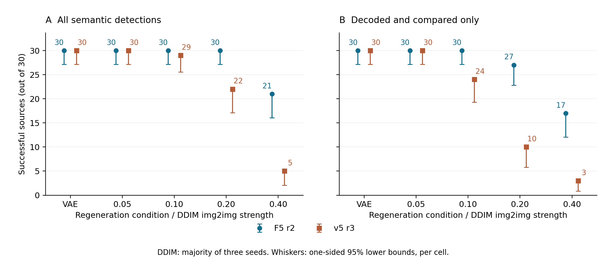

# Chapter 5. Results

Status: **draft for human review**, 2026-10-07. This chapter reports the frozen M2 run; it does not record M2 acceptance or chapter finalization. Research-question labels retain their meaning in the protected proposal ledger. English descriptions below are operational summaries; the exact approved Persian wording is preserved in [the writing map](../m2-writing-map.md).

## 5.1 Evidence set and reading conventions

<!-- claim=M2-R-001; kind=result; evidence=EV-ENDPOINTS,EV-VERIFICATION,EV-REVIEW; status=verified; proposal=DATA-01 -->
The confirmatory evidence comprises 300 held-out COCO val2017 source representatives, canonicalized to 512 × 512 pixels. The completed continuation, `coco512-confirm-rerun-1`, contains all 7,741 planned journal rows, with no missing or extra rows. Independent endpoint recomputation reproduces all counts and structures; the largest difference among 192 floating-point bound values is 2.22 × 10⁻¹⁶. These are the results of the narrowed COCO512 protocol, rather than completion of the proposal's three-dataset study.
<!-- /claim -->

<!-- claim=M2-R-002; kind=limitation; evidence=EV-PACKAGE,EV-SPEC,EV-REVIEW; status=verified; proposal=METHOD-06,METHOD-08,RQ-02 -->
F5 r2 and the retained v5 r3 comparator are complete systems with different embedding and detection designs. Both alter image pixels. F5 optimizes a perturbation through the pinned SD1.5 VAE encoder and reads a DCT pattern from its encoder latent; v5 uses an image-domain carrier. F5 also changes semantic pooling, matching and perturbation strength. This comparison therefore measures the frozen systems together. It does not isolate carrier location as the cause of a difference, and F5 is not the proposal's initial-noise embedding route.
<!-- /claim -->

<!-- claim=M2-R-003; kind=limitation; evidence=EV-PACKAGE,EV-ENDPOINTS,EV-REVIEW; status=verified; proposal=METRIC-05,METRIC-06 -->
C0 denotes an unmarked image and C1 its marked counterpart. A correct-owner query supplies the intended public OwnerID; a wrong-owner query supplies the declared alternative. `both_match` requires both watermark tiers, while `any_found` is the more permissive negative-call event. For T3, the semantic success rule includes decoded-and-compared codes and recomputed-only owner detections. The latter are labelled “assumed”; they must not be described as recovered payloads. DDIM success is aggregated by source, requiring success on at least two of three seeds. Repeated seed rows and patch sizes are not additional independent images. Reported confidence bounds are one-sided 95% Clopper–Pearson bounds for each cell, under the protocol's independent-unit assumption, without simultaneous coverage.
<!-- /claim -->

The numerical exhibits are derived directly from the retained endpoints. [Table data and provenance](../evidence/m2-exhibits-provenance.json) record the input checksum and generation script. The [corrected M2 report](../../research/m2-coco512-results.md) and [independent review](../../research/m2-independent-review.md) provide the audit trail.

## 5.2 RQ1: combined semantic and perceptual signature

<!-- claim=M2-R-004; kind=limitation; evidence=EV-REVIEW,EV-CLAIM-LEDGER; status=verified; proposal=RQ-01,HYP-01,OBJ-01 -->
The run does not contain a combined-versus-semantic-only signature ablation. It consequently does not estimate the benefit of combining CLIP-derived semantic information with a perceptual hash, or establish signature uniqueness and stability as posed by RQ1/HYP1. The T5 different-owner collision results in Section 5.5 describe the implemented detector under its fixed owner conditioning. They are not a substitute for that ablation. RQ1 remains unanswered by this experiment. **TODO:EVIDENCE — a controlled T5 signature comparison is absent.**
<!-- /claim -->

## 5.3 RQ2: survival under regeneration

### 5.3.1 Matched SD1.5 outcomes

<!-- claim=M2-R-005; kind=result; evidence=EV-ENDPOINTS,EV-REVIEW; status=verified; proposal=RQ-02,HYP-02,METRIC-05 -->
T3 uses 30 held-out sources, a VAE cycle, and SD1.5 DDIM20 img2img at strengths 0.05, 0.10, 0.20 and 0.40, with seeds 0, 1 and 2. Both systems detect the semantic tier on all 30 VAE-cycle sources and all 30 sources at strength 0.05. At strength 0.10, source-majority semantic detection is 30/30 for F5 and 29/30 for v5. At strength 0.20 it is 30/30 versus 22/30, and at strength 0.40 it is 21/30 versus 5/30. These differences correspond to 8 and 16 additional successful sources at the two stronger doses.
<!-- /claim -->

Table 5.1. T3 source outcomes; each entry is out of 30 sources. LB is the per-cell one-sided 95% lower bound for the semantic success rate.

| Condition | F5 semantic | v5 semantic | F5 semantic LB | v5 semantic LB | F5 checked only | v5 checked only |
|---|---:|---:|---:|---:|---:|---:|
| VAE cycle | 30 | 30 | .905 | .905 | 30 | 30 |
| DDIM .05 | 30 | 30 | .905 | .905 | 30 | 30 |
| DDIM .10 | 30 | 29 | .905 | .851 | 30 | 24 |
| DDIM .20 | 30 | 22 | .905 | .570 | 27 | 10 |
| DDIM .40 | 21 | 5 | .535 | .068 | 17 | 3 |

The VAE cycle has one outcome per source; each DDIM cell has three seeds. Full-precision values and checked-only bounds are in [the T3 table](../tables/m2-t3.md).

Figure 5.1. Source-level survival for the frozen systems on the pinned SD1.5 regenerator. Panel A includes checked and recomputed-only detections; Panel B requires a decoded-and-compared code. Whiskers show only the existing one-sided 95% lower bounds. DDIM points are source-majority outcomes over three seeds. Conditions are categorical; no intermediate strength or other regenerator is inferred. [Vector PDF](../figures/m2-t3-survival.pdf) and [SVG](../figures/m2-t3-survival.svg) are available for later typesetting.

<!-- claim=M2-R-006; kind=result; evidence=EV-ENDPOINTS,EV-REVIEW; status=verified; proposal=RQ-02,METHOD-09 -->
The advantage persists when only decoded-and-compared semantic codes count as success. Checked-only source outcomes are 30/30 versus 24/30 at strength 0.10, 27/30 versus 10/30 at 0.20, and 17/30 versus 3/30 at 0.40. At 0.20, F5's 87/90 semantic-positive seed rows comprise 79 checked and 8 assumed detections; v5's 62/90 comprise 30 checked and 32 assumed. At 0.40 the corresponding totals are 60/90 (51 checked, 9 assumed) and 14/90 (7 checked, 7 assumed). This distinction prevents a recomputed-only response from being reported as payload recovery.
<!-- /claim -->

### 5.3.2 Paired sources and negative controls

Table 5.2. Frozen descriptive paired sign tests. “F5 only” and “v5 only” are discordant source counts. The p-values are two-sided and unadjusted.

| Rule | Strength | F5 only | v5 only | Both | Neither | p |
|---|---:|---:|---:|---:|---:|---:|
| Semantic | .05 | 0 | 0 | 30 | 0 | n/a |
| Semantic | .10 | 1 | 0 | 29 | 0 | 1 |
| Semantic | .20 | 8 | 0 | 22 | 0 | .0078125 |
| Semantic | .40 | 16 | 0 | 5 | 9 | .00003052 |
| Checked only | .05 | 0 | 0 | 30 | 0 | n/a |
| Checked only | .10 | 6 | 0 | 24 | 0 | .03125 |
| Checked only | .20 | 17 | 0 | 10 | 3 | .00001526 |
| Checked only | .40 | 14 | 0 | 3 | 13 | .00012207 |

<!-- claim=M2-R-007; kind=result; evidence=EV-ENDPOINTS,EV-REVIEW; status=verified; proposal=RQ-02,METRIC-05 -->
At strengths 0.20 and 0.40, the semantic paired discordances are 8–0 and 16–0 in F5's favour. No v5-only source success occurs at any declared DDIM strength. These tests describe the selected 30 sources and the frozen event rules; they do not provide a causal attribution to the latent carrier or a multiplicity-adjusted family-level conclusion. For both methods, every T3 condition has zero `any_found` detections on C0 and wrong-owner queries. The corresponding source-level upper bound is .0950, so this small threat cohort does not establish a false-detection rate below 1%.
<!-- /claim -->

<!-- claim=M2-R-008; kind=result; evidence=EV-ENDPOINTS,EV-REVIEW; status=verified; proposal=METHOD-09,RQ-02 -->
Neither system retains `both_match` on any T3 correct-owner row, including the VAE cycle. F5's 390 such rows end in 357 `semantic_only`, 21 `content_uncertain`, 11 `neither_match` and 1 `content_mismatch` states; v5 gives 283, 13, 91 and 3 respectively. The surviving semantic evidence therefore does not authenticate the original instance tier after regeneration. The decision states also do not establish a classifier of attack cause.
<!-- /claim -->

<!-- claim=M2-R-009; kind=interpretation; evidence=EV-REVIEW,EV-SPEC,EV-PACKAGE; status=partial; proposal=RQ-02,HYP-02,METHOD-06,METHOD-08 -->
RQ2/HYP2 is partially supported by the improved semantic survival of the complete frozen F5 system in this SD1.5 test. Its original causal formulation, that moving the embedding location alone improves survival, remains unresolved. F5 simultaneously changes semantic pooling, matching and embedding, and uses a VAE-assisted pixel perturbation. **TODO:EVIDENCE — a matched component ablation is required to identify the carrier-location effect.**
<!-- /claim -->

## 5.4 RQ3: detection performance and computational cost

<!-- claim=M2-R-010; kind=limitation; evidence=EV-REVIEW,EV-SPEC,EV-CLAIM-LEDGER; status=verified; proposal=RQ-03,HYP-03,OBJ-03,METRIC-07,CLAIM-01 -->
The run contains no neural-decoder or SEAL/inversion comparator evaluated under a common timing and accuracy protocol. F5 extraction uses the VAE encoder and seven CLIP views in addition to DCT analysis. Absence of diffusion inversion is an implementation property; it does not establish that the full detector is lightweight or faster than a neural alternative. RQ3/HYP3 is untested. **TODO:EVIDENCE — matched full-verification latency, resource use and detection comparisons are absent.**
<!-- /claim -->

<!-- claim=M2-R-011; kind=result; evidence=EV-ENDPOINTS,EV-REVIEW; status=verified; proposal=METRIC-07 -->
Mean embedding time in the retained run is 22.354 seconds for F5 and 2.296 seconds for v5, approximately a tenfold difference. These are embedding measurements from a continuation using two hardware environments. They are not detector latency, a controlled cross-hardware benchmark, or evidence against a reproduced SEAL system. The chapter reports them as run resource observations only.
<!-- /claim -->

## 5.5 RQ4: copied-watermark rejection and semantic collisions

### 5.5.1 T4 copy-paste

Table 5.3. Fixed-threshold copy-paste outcomes. The different-owner false-attribution rate uses 29 pairs; the delivery witness uses all 30 pairs. Rows represent patch sizes and are clustered within pairs.

| Outcome | F5 r2 | v5 r3 | F5 error upper bound |
|---|---:|---:|---:|
| False donor full attribution, pair-level | 0/29 | 0/29 | .0981 |
| False donor full attribution, rows | 0/58 | 0/58 | — |
| Recipient claim `any_found`, rows | 0/58 | 0/58 | — |
| C0 donor sham `any_found`, rows | 0/120 | 0/120 | — |
| Donor semantic-consistency error, rows | 3/58 | 5/58 | — |
| Donor delivery witness, pairs | 4/30 | 8/30 | positive observation |

<!-- claim=M2-R-012; kind=result; evidence=EV-ENDPOINTS,EV-REVIEW; status=verified; proposal=RQ-04,HYP-04,PROB-01 -->
T4 copies centered 128 × 128 and 256 × 256 donor patches into recipients, with a C0-donor sham control. Neither method produces false donor full attribution in the 29 different-owner pairs. Pair 5 shares an owner and is reported separately, as declared. F5 reveals a donor-delivery witness in 4/30 pairs, compared with 8/30 for v5. Across the 60 marked-donor claim rows, F5 gives 56 `neither_match`, 3 `semantic_only` and 1 `content_uncertain`, with no `content_mismatch`; v5 gives 52, 6, 1 and 1 in the states `neither_match`, `semantic_only`, `content_uncertain` and `content_mismatch` respectively.
<!-- /claim -->

<!-- claim=M2-R-013; kind=interpretation; evidence=EV-REVIEW,EV-ENDPOINTS; status=partial; proposal=RQ-04,HYP-04,OBJ-04,METRIC-06 -->
The zero false-full-attribution result supports rejection under the declared T4 construction, with an upper error bound of .0981. It does not demonstrate the proposed mechanism of detecting a copied watermark through a content mismatch. Most F5 splice queries lack a detectable donor mark, and none reports `content_mismatch`; loss or nondelivery of the mark is sufficient to explain much of the rejection. The weaker delivery witness must remain visible. RQ4/HYP4 is partially supported at the fixed-threshold rejection endpoint; comparative binding efficacy and the proposal's ACC/AUC endpoint are not established. **TODO:EVIDENCE — a binding-disabled comparison with measurable mark delivery is absent.**
<!-- /claim -->

### 5.5.2 T5 semantic collision

<!-- claim=M2-R-014; kind=result; evidence=EV-ENDPOINTS,EV-REVIEW,EV-PACKAGE; status=verified; proposal=PROB-03,RQ-01 -->
The fixed T5 selector produces 30 pairs with matching COCO category signatures and the declared perceptual-separation constraint. Same-owner pairs 9, 20 and 29 are excluded from the false-match rate as planned, leaving 27 different-owner pairs. Both systems have zero false `both_match` and zero `any_found` events for both C0 and C1 conditions. Each pair-level upper bound is .1050. Public owner conditioning remains part of these queries, so the result cannot isolate a semantic/perceptual binding benefit over a semantic-only signature.
<!-- /claim -->

## 5.6 Clean performance, quality and completeness

### 5.6.1 Primary clean detection

Table 5.4. Primary clean endpoints, with 300 sources in each cell. LB/UB are per-cell one-sided 95% bounds.

| Cell | F5 r2 | v5 r3 | F5 bound | Frozen numerical target |
|---|---:|---:|---:|---:|
| C1, correct owner, `both_match` | 299/300 | 300/300 | LB .9843 | LB ≥ .80 |
| C0, correct owner, `any_found` | 0/300 | 0/300 | UB .009936 | UB ≤ .01 |
| C0, wrong owner, `any_found` | 0/300 | 0/300 | UB .009936 | UB ≤ .01 |
| C1, wrong owner, `any_found` | 0/300 | 0/300 | UB .009936 | UB ≤ .01 |

<!-- claim=M2-R-015; kind=result; evidence=EV-ENDPOINTS,EV-REVIEW; status=verified; proposal=METHOD-09 -->
F5 returns `both_match` on 299/300 clean correct-owner C1 queries, and v5 on 300/300. F5's lower success bound is .984285, above the frozen .80 target. Each method has 900 distinct negative clean calls, arranged as three 300-source cells, with zero `any_found` events in each. Their upper bounds are .009936 per cell. Secondary `both_match` negatives reuse these calls; counting both rules would duplicate observations. The 900 queries also share source images, so they are not pooled into an independent 900-image error estimate.
<!-- /claim -->

<!-- claim=M2-R-016; kind=result; evidence=EV-ENDPOINTS,EV-REVIEW,EV-VERIFICATION; status=verified; proposal=METHOD-09 -->
Both methods self-verify on 300/300 embeddings, but this operation supplies source semantic features. Primary detection recomputes features from the marked image. F5's actual clean miss is source `399205`, returned as `content_uncertain`, with semantic distance 6.04136 against radius 6. The self-verification result must therefore not replace the primary 299/300 endpoint.
<!-- /claim -->

### 5.6.2 Image quality

Table 5.5. Strict proposal thresholds applied to all 300 source images. All failures remain in the evidence set.

| Measure | F5 r2 | v5 r3 |
|---|---:|---:|
| PSNR > 35 dB | 300/300 | 300/300 |
| SSIM > .9 | 300/300 | 300/300 |
| LPIPS < .1 | 298/300 | 300/300 |
| All three jointly | 298/300 | 300/300 |
| Mean PSNR (dB) | 44.4885 | 37.5320 |
| Mean SSIM | .983332 | .978668 |
| Mean LPIPS | .0217589 | .0207316 |
| Maximum LPIPS | .104195 | .0815718 |

<!-- claim=M2-R-017; kind=result; evidence=EV-ENDPOINTS,EV-REVIEW,EV-SPEC; status=verified; proposal=METRIC-01,METRIC-02,METRIC-03 -->
F5 meets the PSNR and SSIM thresholds on every source, but LPIPS and joint quality on only 298/300. Sources `553094` and `134886` have LPIPS .10222657 and .10419527. The F5 mean, .02175893, and maximum, .10419527, also exceed the development freeze limits of .0173 and .050. The approved confirmatory protocol reports quality counts; passing the primary detection endpoints does not imply universal quality attainment. Held-out human visual and semantic assessments remain missing.
<!-- /claim -->

### 5.6.3 Evidence and continuation limits

<!-- claim=M2-R-018; kind=limitation; evidence=EV-REVIEW,EV-VERIFICATION,EV-REPORT; status=verified; proposal=DATA-01 -->
The continuation preserves the parent's 155-row journal prefix and all 43 retained parent images. Its scientific core is unchanged. Fourteen sources were embedded on the Windows laptop and 286 on the Linux server, making the evidence a single mixed-hardware realization; F5 GPU embedding is not bit-reproducible. The parent's finalized `outputs/run.json` is missing, and its dispatcher record remains `running`, so retained records cannot independently prove the termination cause. The direct user exception and pre-run review waiver are recorded through transcribed references, and independent review was retrospective. Changed approval expiry and rented-server accounting are explicit provenance limits; no missing stop record was reconstructed. No scientific rerun was found necessary by the independent review.
<!-- /claim -->

The claim-level interpretation and remaining research obligations follow in [Chapter 6](06-discussion.md). Raw images and private approval files are not included in this writing package.
